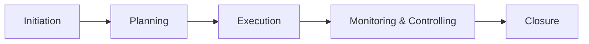

#### title: Project Management (Lecture 8) tags: [project-management, software-engineering, lecture-notes] aliases: [PM Lecture 8, Project Management Notes] source: Lecture_8_Project_Mnagement_ppt.pdf

# Project Management

## 1. Core Definitions

- **Project**: a group of milestones or phases, activities or tasks that support an effort to accomplish something.
- **Management**: the process of **Planning, Organizing, Controlling and Measuring**.
- **Project (formal)**: a collection of linked activities, carried out in an organised manner, with a clearly defined **start point** and **end point**, to achieve specific results that satisfy the needs of the organisation at the current time.
- **Project Management**: a dynamic process that uses the organisation's resources in a controlled and structured way to achieve clearly defined objectives identified as needs. It is **always conducted within a defined set of constraints**.

> [!tip] One-line summary Project = linked activities with a start and end. Management = plan, organize, control, measure.

---

## 2. Characteristics of a Project

- Temporary, with a defined start and end
- Unique deliverables (software product, system, research prototype, etc.)
- **Progressive elaboration**: detailed planning evolves as the project progresses
- Involves multiple stakeholders

---

## 3. Importance in Engineering

- Ensures timely delivery of software and hardware projects
- Balances scope, cost and time (the [[#4. The Triple Constraint|triple constraint]])
- Improves teamwork, communication and risk control

---

## 4. The Triple Constraint

Three goals that must all be met:

|Constraint|Goal|
|---|---|
|**Scope**|What is delivered|
|**Time**|When it is delivered|
|**Cost**|Budget spent|

> [!note] Successful project management means meeting all three goals **and** satisfying the project's sponsor. The slide shows this as hitting the bullseye on a target.

---

## 5. What Project Management Entails (POCM)

|Function|Key idea|
|---|---|
|**Planning**|Most critical, yet gets the least amount of time. "Begin with the end in mind" (Stephen Covey)|
|**Organizing**|Orderly fashion, handling contingent tasks and prerequisites|
|**Controlling**|Critical to use limited resources wisely|
|**Measuring**|Determine whether the goal or target was met|

### Measuring: questions to ask

- Are we efficient?
- Are we productive?
- Are we doing a good job?
- What is the outcome?
- Is it what we wanted it to be?

> [!quote] Two rules from the lecture
> 
> - If you can't plan it, you can't do it.
> - If you can't measure it, you can't manage it.

---

## 6. Project Life Cycle

|Phase|What happens|
|---|---|
|**Initiation**|Define goals, feasibility and stakeholders|
|**Planning**|Develop scope, **WBS** (Work Breakdown Structure), schedule, cost estimation, risk management|
|**Execution**|Carry out planned tasks, allocate resources, ensure team collaboration|
|**Monitoring & Controlling**|Track performance using **KPIs**, manage risks, adjust plans|
|**Closure**|Deliver final product, evaluate performance, document lessons learned|

---

## 7. Who Uses Project Management and Why

**Who**

- Nearly everyone to some degree: people plan days, weeks, vacations and budgets, and keep a simple PM tool known as a **"To Do" list**.
- Any process or means used to track tasks or efforts toward a goal can count as project management.

**Why**

- To track or measure progress toward a goal
- To maximize and optimize resources to accomplish goals

**How much time does it take?**

- Not much. More time is usually wasted from _lacking_ a PM tool than is spent planning, organizing, controlling and measuring.
- How long: as long as there are things to do.

---

## 8. Why Project Management Is Important

- Maps out a course of action or work plan
- Helps us think systematically and thoroughly
- Fits the nature of projects: **unique task, specific objective, variety of resources, time bound**

---

## 9. Project Management Processes (PMBOK Guide)

|Knowledge area|Focus|
|---|---|
|**Integration**|Coordination of all processes|
|**Scope**|Defines boundaries of work|
|**Time**|Scheduling (Gantt charts, CPM, PERT)|
|**Cost**|Budgeting and resource allocation|
|**Quality**|Ensures product meets standards (ISO, CMMI)|
|**Human Resource**|Team roles, leadership, motivation|
|**Communication**|Stakeholder reporting, progress updates|
|**Risk**|Identify, analyze, mitigate risks|
|**Procurement**|Contracts and external vendors|

---

## 10. Tools and Techniques

- **Traditional**: Gantt Chart, **CPM** (Critical Path Method), **PERT** (Program Evaluation Review Technique)
- **Agile and modern**: Scrum, Kanban, Extreme Programming (XP)
- **Tracking tools**: JIRA, Trello, MS Project
- **Software engineering specific**: version control (Git), CI/CD pipelines, automated testing

---

## 11. Advantages of Using PM Tools

- Built-in monitoring and sequencing
- Easy, early identification of bottlenecks
- Activity-based costing
- Identification and addition of missing and new activities
- Preempting unnecessary activity or expenditure
- Timely completion
- Assigning tasks
- Reporting

---

## 12. Road to Better Project Management

1. Find a project plan that fits your style and needs (can be as simple as templates, forms and spreadsheets)
2. Form a **Project Management Committee (PMC)**
3. List all tasks and sub-tasks needed to accomplish the goal
4. Note the time period and the person responsible for each task or sub-task
5. Identify a **Project Manager**
6. Identify **Task Managers**
7. Sequence the activities in relation to the time period
8. Present to the PMC
9. Finalize by reaching an agreement, then start work

---

## 13. Implementation

- Regular monitoring
- Resource support
- Discuss critical issues and find solutions
- Meet the team at completion of each major milestone
- Track progress against the plan
- Have a system to add or delete tasks in the PMT (Project Management Tool)

---

## 14. Consequences of Not Using a PMT

- **Delay**
- **Cost** overruns
- **Waste of resources**
- Poor **quality**
- **Dissatisfaction**
- Damaged **reputation**

---
## Related

- [[Agile and Scrum]]
- [[Software Development Life Cycle]]
- [[Risk Management]]
- [[Gantt Chart, CPM and PERT]]